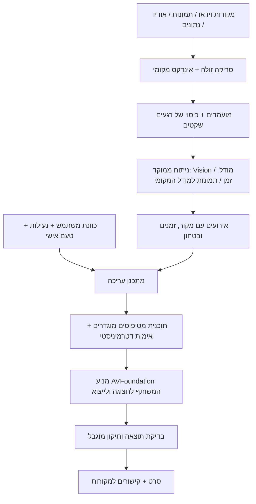

# RK Motion — עשרה שדרוגי מוצר ועשרים יכולות AI מקומיות

**תאריך מחקר:** 23.10.2026. **בסיס קוד:** `erez1980/rk-motion`, ענף `main`, קומיט `bc102a18135b76be59990793e4b79c4799c1b257`, גרסה **0.31.0**.

זו סקירת יכולות, כיוון מוצר והיתכנות טכנולוגית. הקוד העדכני נקרא ב־snapshot נפרד; אין כאן בדיקת ביצועים חדשה, הרצת אפליקציה באייפון או אישור מחדש של כל הבאגים מהסקירה הקודמת. קוד המוצר לא שונה.

## ההמלצה המרכזית

להפוך את RK Motion לעורך שמבין אירוע שלם, יודע מה המשתמש רוצה לזכור ממנו, ומפיק סרט שהוא גם אישי וגם נאמן למה שצולם. להתחיל ברכיבה ובאקשן כתחום שאפשר להצטיין בו ולמדוד אותו, ובהמשך להרחיב את אותו מנוע לטיולים, משפחה ואירועים.

ההזדמנות לבידול היא השילוב של **הבנת אירועים בזמן + העדפות אישיות + נתונים מדודים + עריכה שניתנת לשליטה ולהסבר + עיבוד מקומי**. כל רכיב בנפרד כבר מופיע במוצרים שונים. אין דרך אחראית להבטיח שיכולת אינה קיימת בשום מוצר בעולם; להלן מועמדים לבידול שדורשים אימות מול מתחרים ומול משתמשים.

## מה כבר קיים — ומה אינו הצעה חדשה

בקוד העדכני יש:

- פרויקטים מקומיים עם מספר סרטונים ותמונות, בחירה אוטומטית של רגעים, חיתוך ידני, שינוי סדר ובחירת אורך.
- עשרה סוגי תוכן: אקשן, מסיבה, טיול, דיבור, משפחה, חיות, ספורט, נוף, אוכל וכללי.
- מדידת שינויי תמונה ועוצמת שמע; זיהוי מוזיקה, דיבור, צחוק/עידוד; זיהוי אנשים, חיות, סצנות ואסתטיקה.
- דעה שנייה ממודל Foundation Models מקומי לסיווג לא חד־משמעי; המלצות שירים, כותרות וכיתוב כשמודל זמין, עם חלופות קבועות.
- התאמת חיתוכים לביטים ושיא הסרט ל־drop, הנמכת מוזיקה בזמן דיבור/עידוד, צבע לפי סוג התוכן, מעברים חכמים ותנועה בתמונות.
- פתיח מהשיא, האטה, speed ramp, זום על הביט ו־whoosh; מסגור אנכי לפי המיקום הרגיל של האנשים בקטע.
- קריאת GPS מתוך GPMF של GoPro והצגת מהירות/גובה/מרחק; שלוש גרסאות של 15/30/60 שניות; Undo/Redo של העריכה הנוכחית.
- מוזיקה מקבצים או מ־YouTube, תצוגה מקדימה, שמירה ל־Photos ופרסום IPA/מקור SideStore ב־CI.

הבדל מהותי: `ModelReading` מקבל כיום **תוויות ומספרים, ולא תמונות**. מדידת תנועה משתמשת בכשני פריימים לשנייה; התבוננות ב־Vision מוגבלת לעד 90 דגימות לסרטון. זה בסיס יעיל לסיווג כללי, אך אינו מוכיח הבנת קפיצה, מהלך או אינטראקציה קצרה. המיקוד האנכי הוא סיכום מיקומי אנשים לכל קטע, ולא מעקב רציף אחר אדם שבחר המשתמש.

מקורות קוד נעולים לגרסה שנבדקה: [README](https://github.com/erez1980/rk-motion/blob/bc102a18135b76be59990793e4b79c4799c1b257/README.md), [ContentReading](https://github.com/erez1980/rk-motion/blob/bc102a18135b76be59990793e4b79c4799c1b257/ios/RKMotion/ContentReading.swift), [LocalEngine](https://github.com/erez1980/rk-motion/blob/bc102a18135b76be59990793e4b79c4799c1b257/ios/RKMotion/LocalEngine.swift), [AIEdits](https://github.com/erez1980/rk-motion/blob/bc102a18135b76be59990793e4b79c4799c1b257/ios/RKMotion/AIEdits.swift), [Effects](https://github.com/erez1980/rk-motion/blob/bc102a18135b76be59990793e4b79c4799c1b257/ios/RKMotion/Effects.swift), [Telemetry](https://github.com/erez1980/rk-motion/blob/bc102a18135b76be59990793e4b79c4799c1b257/ios/RKMotion/Telemetry.swift), [EditorModel](https://github.com/erez1980/rk-motion/blob/bc102a18135b76be59990793e4b79c4799c1b257/ios/RKMotion/EditorModel.swift), [מסכי עריכה וייצוא](https://github.com/erez1980/rk-motion/blob/bc102a18135b76be59990793e4b79c4799c1b257/ios/RKMotion/ProjectFlowView.swift).

## תמונת השוק — כדי לכוון לבידול אמיתי

| מוצר שנבדק | יכולות מתועדות שכבר קיימות | המשמעות ל־RK Motion |
|---|---|---|
| GoPro Quik | סרטי highlights, התאמה לביטים; שימוש בנתוני מצלמה לזיהוי רגעים | סנכרון ביטים או שימוש ב־GPS לבדם אינם חידוש. [Quik](https://gopro.com/en/us/shop/quik-app-video-photo-editor), [Metadata ו־Auto HiLights](https://gopro.com/en/gb/news/quik-moments-updates-and-gpmf) |
| Insta360 | בחירת רגעים, מסגור, זיהוי סצנות, התאמת מוזיקה ונתוני Garmin/Watch | יש צורך להציע הבנה ושליטה עמוקות יותר מהצעת קליפים. [Auto Edit](https://onlinemanual.insta360.com/app/en-us/operation-tutorial/edit-function/auto-edit), [Stats](https://onlinemanual.insta360.com/x3/en-us/camera/stats/statsdashboard) |
| CapCut | חיתוך אוטומטי לפי מוזיקה, דיבור או תסריט | שיחה עם עורך, תמלול וכתוביות הם שימושיים, אך קטגוריות מוכרות. [Auto Cut](https://www.capcut.com/help/auto-cut-in-capcut) |
| Apple Photos | סרט זיכרונות לפי תיאור, עם סיפור ומוזיקה | הפקת סרט לפי בקשה לבדה אינה בידול. [Memory movies](https://support.apple.com/en-gb/guide/iphone/iphee2ee53fe/27/ios/27) |
| CamJam | לפי תיעוד היצרן: עריכה לפי ביטים על הטלפון, ללא ענן או חשבון | גם offline כשלעצמו כבר אינו ייחודי. זו טענת יצרן שלא נבדקה בהתקנה עצמאית. [Offline editor](https://getcamjam.com/offline-video-editor/) |
| Onform / SwingVision | מעקב גוף, השוואת ביצועים, ניתוח ענפי ו־highlights | מאמן AI או השוואה בין ניסיונות צריכים התמחות והוכחת דיוק. [Onform](https://support.onform.com/article/116-analysis-tools), [SwingVision](https://swing.vision/) |
| DaVinci Resolve | בחירת זוויות אוטומטית ב־multicam | החידוש המוצע הוא התאמה לאירועי שטח במכשיר, לא עצם קיום multicam. [מדריך Resolve 20](https://documents.blackmagicdesign.com/SupportNotes/DaVinci_Resolve_20_New_Features_Guide.pdf) |

זה מדגם של תיעוד פומבי, לא מיפוי מלא, חוות דעת פטנטים או בדיקת כל גרסה ואזור. לא התקנתי את המתחרים במסגרת הסבב הזה.

## 10 שדרוגים כלליים

### G01 — ענפי עריכה וגרסאות שנשמרות בין הפעלות

כבר יש Undo/Redo. השדרוג הוא שמירת גרסאות עם שמות, הסתעפות מאותה נקודה והשוואת שני כיווני עריכה, בלי לשכפל את קובצי המקור. המשתמש יכול לחזור גם אחרי סגירה ולעשות ניסוי בלי לפחד לאבד סרט מוצלח.

**קבלה:** פתיחה מחדש משחזרת גרסאות; מחיקת ענף אינה מוחקת מקור שמשמש ענף אחר; אפשר לשחזר את תוכנית העריכה המדויקת של כל export.

### G02 — Timeline מדויק עם קטעים נעולים

להוסיף זום ברמת פריים, waveform, סימוני מוזיקה ואירועים ונעילה של קטעים/גבולות שהמשתמש תיקן. כל חיתוך אוטומטי נוסף חייב לכבד נעילות. זה משלים את בחירת הקטעים וה־trim הקיימים, בלי להפוך את מסך ברירת המחדל למורכב.

**קבלה:** שינוי אורך/מוזיקה/סוג תוכן אינו מזיז גבול נעול; קיימת התנהגות מפורשת כשאי אפשר לעמוד גם באורך וגם בנעילות.

### G03 — ייבוא של יום צילום שלם

ייבוא מסודר מ־Photos, Files, כרטיס SD ו־SSD, עם תור, המשך אחרי הפרעה, בדיקת כפילויות, סדר לפי זמן צילום ואזהרה על חלק חסר. להרחיב את הייבוא וההתאוששות שכבר נוספו, ולא להחליף אותם.

**קבלה:** ניתוק כונן אינו פוגע בפרויקט; חיבור מחדש מחזיר רק את החלק החסר; קבצים בעלי שם זהה אינם מתמזגים בטעות.

### G04 — תוצאה ראשונה מהירה ועיבוד בשלבים

להציג rough cut לפני גמר כל הניתוח, לשמור תוצאות ביניים ולהעמיק רק בקטעים מועמדים. להשתמש ב־proxies כשצריך ובתקציב חום/זיכרון ברור. במצב איכות גבוהה מרחיבים את הבדיקה גם מעבר למועמדים הראשונים, כדי לא להחמיץ רגעים שקטים.

**קבלה:** מודדים זמן לתצוגה הראשונה, זמן כולל, peak memory וצריכת סוללה; ביטול/רקע ממשיכים מהשלב שנשמר. הבטחות מספריות רק אחרי מדידה באייפון.

### G05 — פרויקט נייד שאפשר לגבות ולשחזר

חבילת פרויקט עם מקורות או הפניות, hashes, עריכות, אינדקס ניתוח וגרסאות מודלים. יצוא ל־Files/SSD/AirDrop ושחזור במכשיר אחר. ענן אינו נדרש, ועיבוד נשאר בטלפון.

**קבלה:** שחזור ללא קישור לנתיב הישן; איתור מקורות חסרים; migration של schema; שמות קבצים ונתונים פרטיים אינם נשמטים בלי החלטה של המשתמש.

### G06 — חוזה איכות לייצוא

בחירה מפורשת של HDR/SDR, קצב פריימים, יחס מסך, codec ואיכות, עם preview שמדגים tone mapping. בדיקת חומר מעורב: H.264/HEVC, וידאו מסובב, קצב משתנה ו־4K/60. אין כאן טענה שכל הפורמטים האלה כרגע שבורים; ההצעה היא להגדיר ולבדוק תמיכה בצורה מסודרת.

**קבלה:** מטריצת קלט/פלט באייפון; צבע, סאונד, משך וסנכרון זהים בין התצוגה לייצוא במגבלות שהוגדרו.

### G07 — מצב שטח שעובד באמת ללא רשת

מסך מוכנות לפני יציאה: כל המקורות, המוזיקה והמודלים הנחוצים זמינים מקומית, עם גודל ויכולת פינוי. עריכה מלאה במצב טיסה. חיפוש YouTube יישאר פעולה מקוונת; אין להסתיר תלות ברשת בתוך כלי AI.

**קבלה:** התקנת נכסים פעם אחת ואז import/analyze/edit/export במצב טיסה, כולל לאחר הפעלה מחדש. אם רכיב חסר, מופיעה חלופה מקומית לפני שהמשתמש מתחיל.

### G08 — נתוני רכיבה מכל מקור, עם שעון אחד

להרחיב מעבר ל־GPS המובנה ב־GoPro: GPX/FIT ונתוני אימון מקומיים מ־HealthKit לפי הרשאה. מסך לתיקון הפרש שעונים, אזור זמן ו־drift. להעדיף ייבוא קובץ מקומי לפני תלות בשירות Garmin/Strava.

**קבלה:** מקור ללא נתונים אינו מקבל מספרים מומצאים; אפשר לראות ולתקן offset; סנכרון נשמר גם אחרי האטה ושינוי סדר.

### G09 — שליטה רצינית בסאונד

מיקסר קל להבנה עם ערוצים למקור, מוזיקה, קריינות ואפקטים; keyframes לעוצמה, crossfades ומדידת headroom/loudness. זו הרחבה לשליטה ידנית; הפרדת מקורות בעזרת AI מופיעה בנפרד ב־AI10.

**קבלה:** preview וייצוא זהים; אין clipping שנוסף מהמיקס; גם בלי מוזיקה מתקבל מקור נשמע ותקין.

### G10 — מסך החלטה לפני שיתוף

השוואה מסונכרנת מקור/תוצר, קפיצה מכל שוט למקור, רשימת השינויים ומצב נגיש לבדיקת הסרט. לייצוא מרובה גרסאות שכבר קיים להוסיף שמות ברורים, יעד ומעקב אחר הצלחות/כישלונות לכל תוצר.

**קבלה:** המשתמש מבין בדיוק מה השתנה; ניתן לבדוק טקסט חתוך, שמע חסר, פריים שחור וגרסה שגויה בלי לחפש ידנית בכל הספרייה.

## מה Apple מאפשרת כיום — והגבולות

**Foundation Models:** בקוד הנוכחי השימוש הוא בטקסט ב־iOS 26 ומעלה. התיעוד העדכני ל־iOS 27 מציג קלט תמונות למודל המקומי; זו הזדמנות לשאול על פריימים נבחרים. אין להסיק מכך קלט וידאו רציף או עיבוד 4K בזמן אמת. לתכנן לפי SDK, runtime, זמינות המודל ותקציב ההקשר; חלק מפרטי ה־API מסומנים Beta בתיעוד. [תמונות ו־multimodal](https://developer.apple.com/documentation/foundationmodels/analyzing-images-with-multimodal-prompting), [WWDC26](https://developer.apple.com/videos/play/wwdc2026/241/).

**Vision:** נותנת מעקב, זיהוי, סגמנטציה וניתוח תנועה; pose דורש גוף נראה באיכות מספקת. מצלמת קסדה לרוב לא רואה את גוף הרוכב ולכן אי אפשר להפיק ממנה אוטומטית מדידות טכניקה שלמות. [Vision](https://developer.apple.com/documentation/vision), [מגבלות pose](https://developer.apple.com/documentation/vision/detecting-human-body-poses-in-images).

**Core ML / Core AI:** מאפשרות הרצת מודלים ייעודיים במכשיר. Core AI העדכנית מוסיפה מסלול פריסה ושליטה במשאבים, אבל אינה מעניקה מעצמה מודל טוב לזיהוי קפיצות או הפרדת רוח מדיבור. צריך לבחור/לאמן/לרשיין מודל, לכמת אותו ולמדוד על חומר אמיתי. [Core AI](https://developer.apple.com/core-ai/), [אינטגרציה](https://developer.apple.com/documentation/CoreAI/integrating-on-device-ai-models-in-your-app-with-core-ai).

**SpeechAnalyzer:** מסלול לתמלול מקומי עם זמני מילים; לבדוק `isAvailable`, רשימת locales ונכסים מותקנים בנפרד מ־Foundation Models. [SpeechAnalyzer](https://developer.apple.com/videos/play/wwdc2025/277/), [SpeechTranscriber](https://developer.apple.com/documentation/speech/speechtranscriber).

**עברית:** אינה ברשימת השפות הנתמכות של Apple Intelligence במסמך Apple שעודכן ב־22.10.2026. תמיכה בעברית בממשק אינה הוכחה להבנת פקודות, תמלול או ניסוח בעברית. לשלב הראשון: פקדים מובנים ושפה נתמכת למודל; אם עברית חופשית הכרחית — PoC למודל מקומי מתאים, עם בדיקת איכות נפרדת. אין להפעיל תרגום ענן שקט. [דרישות Apple](https://support.apple.com/en-us/121115), [בדיקת שפות במודל](https://developer.apple.com/documentation/foundationmodels/supporting-languages-and-locales-with-foundation-models).

**מקומי פירושו בחירה מפורשת במסלול מקומי.** Private Cloud Compute נשאר חישוב מחוץ לאייפון גם כשהוא פרטי. הוא אינו מתאים לדרישה שלך. אין להחליף אליו אוטומטית כאשר המודל המקומי נכשל. הורדה ראשונית של מודל אינה עיבוד בענן, אבל צריך להציג אותה לפני מצב offline.

**למידה אישית אינה מחייבת לאמן את מודל Apple.** אפשר ללמוד משקלים/דירוגים קטנים מקומית. ה־adapter toolkit הישן של Apple מצוין בתיעוד כלא תואם ל־OS 27; אין לבנות עליו את התוכנית. [Adapters](https://developer.apple.com/apple-intelligence/foundation-models-adapter), [MLUpdateTask למודלים מתאימים](https://developer.apple.com/documentation/coreml/mlupdatetask).

**רקע:** inference אינו זכות בלתי מוגבלת כשהמסך כבוי. ב־iOS 27 מתועד entitlement לעיבוד Neural Engine ברקע. יש לבחון חתימה/פרופיל ויכולות זמינות במסלול ההתקנה האישי, ולהחזיק מצב קדמי עם checkpoint כחלופה. [Background inference](https://developer.apple.com/documentation/bundleresources/entitlements/com.apple.developer.background-tasks.continued-processing.inference), [Release notes](https://developer.apple.com/documentation/ios-ipados-release-notes/ios-ipados-27-release-notes).

## 20 יכולות AI מוצעות

הסימון **פיתוח** פירושו שהרכיבים הבסיסיים זמינים ויש דרך הנדסית להתחיל; הוא אינו הבטחה לאיכות מוכחת. **PoC** דורש ניסוי שמכריע היתכנות. **מחקר** הוא יעד שאפתני עם אי־ודאות ממשית. כל יעדי המדידה להלן הם הצעות לשערי קבלה, לא תוצאות שכבר הושגו.

### AI01 — מפת אירועים שמבינה מה קרה ⭐

לפצל את הסרט לאירועים ברמת משמעות, לא רק לקטעים עם הרבה תנועה: הכנה → ניסיון → שיא → תוצאה → תגובה. ברכיבה: גישה, קפיצה, נחיתה וצחוק; במשפחה: הכנת העוגה, כיבוי הנרות והתגובה. לשמר קישורים בין אירועים שמופיעים בקבצים נפרדים.

**מימוש מקומי:** דגימה מדורגת, Vision, embeddings, מודל זמן קטן; ב־iOS 27 להשתמש בפריימים נבחרים גם עם Foundation Models ולשמור תוצאה מובנית. מודל תמונה לבדו אינו תחליף למודל רצף.

**מצב:** PoC. **ניסוי:** תיוג ידני של אירועים קצרים וארוכים; למדוד precision/recall לכל סוג אירוע, שגיאת גבולות ושיעור ״לא בטוח״. לאחד תוויות רק כשיש מספיק ראיות.

### AI02 — להפריד אקשן מטלטול מצלמה

לזהות צילום מעניין גם כשהמצלמה יציבה, ולהוריד דירוג לבליטות דרך, סיבוב קסדה או מעבר חד בחשיפה. כיום שינויי פיקסלים ורעש עשויים להיות סימן לאנרגיה; השדרוג מבדיל תנועת מצלמה מתנועת הנושא.

**מימוש מקומי:** optical flow, הערכת תנועה גלובלית/מקומית, מודל זמן; gyro רק כשנשמר במקור או הוקלט בפועל. אין נתוני חיישן שאפשר להמציא בדיעבד.

**מצב:** PoC. **ניסוי:** דוגמאות של דרך משובשת מול קפיצה חלקה וסצנות רגועות חשובות; למדוד שיעור false highlights מול הבסיס הקיים.

### AI03 — איסור חיתוך באמצע הרגע

המערכת מבינה שנחיתה, סיום משפט, תוצאת משחק או תגובת ילד הם חלק מהאירוע. חיתוך לפי ביט או אורך יעד לא יוכל למחוק אותם בלי ליידע את המשתמש. זה מחבר את ההבנה ל־optimizer שמייצר את הסרט בפועל.

**מימוש מקומי:** גבולות AI01, זמני דיבור מ־SpeechAnalyzer, אילוצי timeline ואופטימיזציה דטרמיניסטית. ה־LLM מציע; קוד בודק גבולות ומבצע.

**מצב:** פיתוח לאחר AI01. **ניסוי:** שיעור אירועים שנחתכו לפני התוצאה; בדיקת נעילות וסרטים שאין דרך לכווץ לאורך המבוקש בלי פגיעה בתוכן.

### AI04 — נתוני רכיבה שמסבירים את הסיפור

לא להסתפק ב״47 קמ״ש״ על המסך. לבחור את הרגע שבו חל שינוי משמעותי ולחבר אותו לתמונה: תחילת ירידה, שיא מהירות, מקטע טיפוס או עצירה קבוצתית. להציג ״למה הרגע הזה נבחר״ עם מקור הנתון.

**מימוש מקומי:** GPMF/GPX/FIT מסונכרנים, זיהוי change points ודירוג משולב עם הווידאו. לא להפיק נתון מדויק של מהירות/גובה מתמונה בלבד.

**מצב:** פיתוח/PoC לסנכרון. **ניסוי:** חומר עם clock drift, GPS חסר ומקורות סותרים; לדחות נתון לא אמין במקום להציגו כעובדה. עצם שימוש בטלמטריה להיילייטס כבר קיים ב־Quik; הבידול הוא עומק ההסבר והשליטה.

### AI05 — סרט של המאמץ, גם כשהרגע לא נראה מהיר

להבליט מאמץ בעלייה, שיפור לאורך אימון או הקלה בסיום באמצעות נתוני פעילות מדודים. עבור ריצה או רכיבה, רגע חשוב יכול להיות איטי ושקט. זו בחירה סיפורית, לא אבחון רגשי או רפואי.

**מימוש מקומי:** HealthKit/קובץ פעילות, שינוי יחסי בקצב/דופק/הספק כשזמינים, התאמה לווידאו והקשר מ־AI01. נדרשת התחשבות בהשהיית דופק ובזמינות חיישנים.

**מצב:** PoC. **ניסוי:** האם המשתמש מדרג רגעי מאמץ כמשמעותיים יותר מהבחירות הקיימות; כל מדד חייב להיות קשור למדידה אמיתית ולהרשאה.

### AI06 — עריכה באמצעות כוונה

לבקש ״45 שניות, יותר נוף, לשמור את שלוש הקפיצות, פחות מעברים״ ולקבל שינוי מדויק עם אפשרות ביטול. לתמוך גם בפקדים שמבטאים אותה בקשה, במיוחד כששפת המשתמש אינה נתמכת.

**מימוש מקומי:** Foundation Models עם guided generation ו־tools שמחזירים תוכנית עריכה מטיפוסים מוגדרים; validation לפני שינוי. הקול הוא ממשק נוסף דרך SpeechAnalyzer, לא תנאי להפעלת התכונה.

**מצב:** פיתוח בשפה נתמכת. **ניסוי:** בנק פקודות, אילוצים סותרים ופקודות חלקיות; בודקים עמידה באילוצים ולא רק אם נוצר JSON תקין.

### AI07 — ללמוד את הטעם של המשתמש ⭐

המשתמש בוחר מדי פעם בין שתי עריכות או מתקן קליפ. האפליקציה לומדת שהוא אוהב נחיתות שלמות, אנשים מסוימים, פחות זומים או יותר טבע. הטעם נשמר מקומית ואפשר לראות, לאפס או להחזיק כמה פרופילים.

**מימוש מקומי:** דירוג pairwise קטן מעל embeddings/תכונות אירועים, עם משקל לתיקונים מפורשים. לא fine-tuning של מודל המערכת.

**מצב:** פיתוח עם ניסוי משתמשים. **ניסוי:** השוואה עיוורת בין personalized לבסיס אחרי כמות מוגדרת של העדפות; לבדוק שאין התדרדרות בגיוון ובאירועים נדירים.

### AI08 — לבחור את גיבור הסרט

לסמן אדם/כלב/רוכב בפריים אחד ולבקש שהסרט יתמקד בו: רגעים שבהם הוא מופיע, תגובות אליו ומסגור שמתחשב בסביבה. זה יותר ממיקום האנשים הממוצע שכבר קיים.

**מימוש מקומי:** tracking, segmentation ו־re-identification בין שוטים, עם אישור ידני במעבר לא ודאי. אין הנחה שאפשר לקבל מ־Photos את שמות וזהויות האנשים אוטומטית.

**מצב:** PoC. **ניסוי:** קסדות דומות, בגדים דומים, הסתרה ותאורה משתנה; מודדים החלפת זהות ושיעור תיקונים. מאגר הזיהוי שייך לפרויקט ונשמר מקומית.

### AI09 — בימוי לפי מבנה מוזיקלי

לבנות התחלה, מתח, שיא ורגיעה לפי מבנה השיר ולפי סיפור הווידאו. לבחור אזור מוזיקלי מתאים ולחבר קטעי מוזיקה באופן שנשמע מכוון. זה מעבר לביט או drop יחיד שכבר קיימים.

**מימוש מקומי:** embeddings לאודיו, זיהוי מקטעים מוזיקליים ותבניות חוזרות, optimizer לתזמון אירועים ו־DSP למעברים. מוזיקה מקובץ מקומי מספיקה; אין צורך ביצירת שיר בענן.

**מצב:** PoC. **ניסוי:** סגנונות מוזיקה מגוונים, בלי להניח שכולם בנויים כמו EDM; מבחן האזנה עיוור ותיעוד איכות חיבורים.

### AI10 — בימוי של צלילי הרגע

לשמר את צליל הנחיתה, הצחוק או המשפט המוצלח גם מתחת למוזיקה; להקטין רוח/רעש ולתת לצליל החשוב מקום רגע לפני חזרה לפסקול. זו הפרדת מקורות ובחירה אמנותית, מעבר ל־ducking הקיים.

**מימוש מקומי:** מודל source separation/denoising קטן ב־Core ML/Core AI, SoundAnalysis ואוטומציית mix. AVFoundation לבדה אינה מנוע הפרדת מקורות.

**מצב:** PoC. **ניסוי:** רוח חזקה, קליפינג והקלטות קסדה; לבדוק דיבור ושמע מקור שלא נפגעו וארטיפקטים. לא לייצר צליל ״אותנטי״ שאינו קיים ולהציגו כמקור.

### AI11 — סרט קבוצתי מכמה מצלמות ⭐

כמה חברים מוסרים קבצים של אותה רכיבה/מסיבה. האפליקציה מזהה את אותו אירוע ובוחרת זווית לכל שלב: גישה ממצלמת קסדה, קפיצה מהצד ותגובה של חבר. זה עריכת אותו אירוע מכמה נקודות מבט, ולא חיבור קבצים בזה אחר זה.

**מימוש מקומי:** סנכרון אודיו, embeddings חזותיים, telemetry/timecode ואומדן drift; מעבר מקומי ב־AirDrop/Files. לניסוי הראשון שלושה קבצים מיובאים, לפני השקעה בהעברת קבצים אוטומטית.

**מצב:** מחקר. **ניסוי:** אירוע קצר עם זוויות חופפות ואז קבוצת קטעים ללא אודיו משותף; למדוד שגיאת זמן, זיהוי אותו אירוע והחלפת זווית. סנכרון אוטומטי אינו מובטח כשאין אות משותף.

### AI12 — אותו מסלול, ניסיונות שונים ⭐

למצוא את אותה פנייה/עלייה/קפיצה מצילומים מתאריכים שונים ולייצר השוואה שמתחילה באותה נקודה במרחב. להדגיש שינוי בזמן, קו תנועה או בחירת מסלול כשיש מקור מדידה אמין.

**מימוש מקומי:** visual place recognition, התאמת מסלול, temporal alignment ו־tracking; GPS משמש עוגן אך אינו מדויק מספיק לבדו. מתחילים split-screen; overlay/ghost רק כששינוי נקודת המבט מאפשר רישום אמין.

**מצב:** מחקר. **ניסוי:** אור, עונה, מהירות וזווית צילום שונים; מודדים שגיאת התאמה ונמנעים מהצגת מסלול תלת־ממדי מומצא. השוואות וידאו מוכרות בשוק; ההתמחות היא התאמת מקטע שטח אוטומטית במכשיר.

### AI13 — מסגור ששומר את סיבת הפעולה

בייצוא אנכי להשאיר בפריים גם את הרוכב וגם את המכשול/הנחיתה; במשפחה לשמור גם את הילד וגם את העוגה. לייצר נתיב מסגור רציף עם מגבלות מהירות והאצה, ובמקרה הצורך לעבור לתצוגה רחבה במקום לחתוך את ההקשר.

**מימוש מקומי:** tracking, saliency, AI01 ומסגור כאופטימיזציה לאורך זמן. אותו סיפור מותאם ל־9:16/1:1/16:9, במקום crop לכל קליפ לפי חציון אנשים.

**מצב:** פיתוח/PoC איכות. **ניסוי:** שיעור איבוד נושא/הקשר, קפיצות מסגור והעדפת צופים. מעקב חכם כבר קיים במתחרים; כאן ההשערה היא שיפור בהקשר של אקשן.

### AI14 — אותו חומר, סיפורים שונים לקהלים שונים

לבנות גרסה טכנית לרוכבים, גרסה רגשית למשפחה וגרסה קולנועית לטיול, עם בחירת אירועים וסדר שונים — לא רק שלושה אורכים. להראות בדיוק מה הוחלף בין הגרסאות.

**מימוש מקומי:** AI01 + פרופילי משקל/אילוצים, יכולת שפה מקומית ומנוע העריכה. פרופיל קהל הוא בחירה מפורשת של המשתמש.

**מצב:** פיתוח לאחר תשתית אירועים. **ניסוי:** צופים מדרגים התאמה לקהל; להוכיח שהתוצאות שונות בתוכן ולא רק במוזיקה ובמשך.

### AI15 — יומן התקדמות עם ראיות מהווידאו

לבחור מיומנות מוגדרת ולבנות רצף של ניסיונות לאורך זמן: למשל הכנה ונחיתה בקפיצה או תנועה בתרגיל. להציג ״הנה ההבדל״ עם מקורות וציון בטחון, ולהפריד עובדות מדודות מהשערות.

**מימוש מקומי:** Vision pose/מודל ייעודי לאותו ענף, זיהוי שלבי פעולה והתאמת ניסיונות. דרוש צילום חיצוני שרואה את הגוף; לא להבטיח זאת ממצלמת קסדה.

**מצב:** מחקר. **ניסוי:** ענף אחד, זווית צילום קבועה ותיוג מומחה. להשוות ל־ground truth לפני טענות על זוויות/דיוק. כלי ניתוח טכניקה קיימים; בידול אפשרי הוא חיבורם לסיפור האישי ולחומר האקשן.

### AI16 — זיכרון מקומי שאפשר לחפש בו

לבקש ״הקפיצה ליד הגשר ואחריה הצחוק של החברים״ ולקבל את הרגע בתוך הסרט, גם בין פרויקטים. חיפוש משלב דיבור, תמונה, זמן ואירועים, לא רק שם פרויקט.

**מימוש מקומי:** אינדקס זמני של embeddings, תמלול/OCR, Core Spotlight וחיפוש משולב. גישה רק לחומר שהאפליקציה קיבלה הרשאה לנתח; לא להניח גישה לאינדקס הפנימי של Photos.

**מצב:** פיתוח בשפות נתמכות, PoC לשאילתות מורכבות. **ניסוי:** recall@k על חיפושים ידועים, קפיצה לחותמת זמן נכונה, עדכון אינדקס במחיקה והפרדה בין משתמשים/פרויקטים.

### AI17 — מצלמה שמחליטה מה לשמור

בעת צילום דרך האפליקציה, לנתח זרם קטן ולשמר חלון לפני ואחרי אירוע. זה מצמצם שעות של חומר משעמם בלי לאבד את ההכנה. עובד רק כש־RK Motion עצמה מצלמת או כשיש אינטגרציה למצלמה; אי אפשר להוסיף buffer בדיעבד לווידאו שלא צולם.

**מימוש מקומי:** AVFoundation, ring buffer בדיסק, מודל קל לאירועים, Core Motion בצילום נתמך וניתוח מלא מאוחר יותר. לא להריץ VLM כבד על כל פריים.

**מצב:** מחקר. **ניסוי:** מדידת missed events, חום, נפח וסוללה; להתחיל במצב שמסמן אירועים תוך שמירת המקור, ורק אחר כך לשקול השמטה אוטומטית.

### AI18 — במאי שמגלה מה חסר לסרט

אחרי מקטע צילום, להציע צילום אחד שמשלים אותו: נוף המקום, סיום העלייה או תגובת המשתתפים. להראות צילום דוגמה מתוך החומר הקיים כשהוא מתאים. בשלב הראשון זה מסייע לבחירה, לא מייצר סצנה שמעולם לא קרתה.

**מימוש מקומי:** מבנה סיפור ב־AI01, זיהוי סוגי שוטים, Foundation Models ופקדים פשוטים. להפעיל בבדיקת החומר ובעצירה, בלי דרישה לצילום רציף ברקע.

**מצב:** PoC. **ניסוי:** האם משתמשים מצלמים השלמה שמתקבלת בגרסה הסופית והאם איכות הסרט משתפרת בהשוואה עיוורת; לא לבלבל בין ״חסר לי מידע״ לבין ״האירוע לא קרה״.

### AI19 — קריינות וכתוביות שמבוססות על עובדות

לנסח סיפור קצר או כתובית מתוך דיבור מזוהה, הערות המשתמש ונתוני פעילות. כל טענה עובדתית מקושרת לפריים/משפט/מדידה: מקום, זמן ומהירות מגיעים ממקור, לא מניחוש מודל. תאריך יצירת פרויקט אינו אוטומטית תאריך האירוע.

**מימוש מקומי:** SpeechAnalyzer, OCR/metadata, Foundation Models עם תוכנית מובנית ומאגר עובדות. תחילה כתוביות/טקסט; קריינות בקול מקומי רק לאחר אימות API, קול ושפה זמינים.

**מצב:** פיתוח בשפה נתמכת. **ניסוי:** factual error rate, דיוק זמנים ושמות, מקור לכל עובדה. פלט תקין לפי schema אינו מוכיח עובדות נכונות.

### AI20 — עורך שבודק ומתקן את הסרט של עצמו ⭐

לאחר rough cut, לעבור על התוצאה ולחפש חזרה מיותרת, קפיצה בלי נחיתה, גיבור שאבד במסגור, שיא מוקדם מדי או סיום חלש. להציע מספר מוגבל של תיקונים ולהסביר אותם, עם אפשרות להשוואה ולביטול.

**מימוש מקומי:** בדיקות דטרמיניסטיות על timeline/audio, בדיקת אירועים שנבחרו, דגימת פריימים ופלט מובנה ממודל מקומי. להגביל לשניים–שלושה סבבים; לא לטעון שמודל השופט את עצמו הוא הוכחת איכות.

**מצב:** PoC. **ניסוי:** שיפוט אנושי עיוור וסט בדיקה שלא שימש לפיתוח; לעצור אם התיקון פוגע בנעילות/עובדות או אינו משפר את המדד.

## הארכיטקטורה שתאפשר זאת בלי להעמיס על האייפון

- להמשיך להשתמש במנוע המקומי ובתוכנית ה־timeline המשותפת. לא לשכתב את כל האפליקציה כדי להכניס AI.
- מודל שפה מתכנן ומתאר; קוד מחשב זמנים, שומר נעילות, מאמת קבצים ומרנדר. `@Generable` מונע חלק משגיאות המבנה, לא טעויות משמעות.
- לבנות סכמת `Event` עם קובץ מקור, טווח זמנים, ישויות, שלב פעולה, ביטחון ומקור ראיה. לשמור גם גרסת מודל/ניתוח כדי לדעת מה צריך לסרוק מחדש.
- לבצע שיתוף decoder/תוצאות בין מודולים, להגביל גודל batch ומספר מודלים בזיכרון ולהפעיל עיבוד כבד לפי תקציב. אין להניח שכל מודל ירוץ על Neural Engine; למדוד היכן הוא רץ בפועל.
- שני מסלולי יכולות: בסיס Vision/AVFoundation למכשירים קיימים; מסלול מתקדם ל־Apple Intelligence ול־iOS 27 לאחר runtime checks. מכשיר שמתקין את האפליקציה ב־iOS 17 אינו בהכרח תומך ב־AI הגנרטיבי.
- לבדוק ניתוק רשת בפועל. התוצאה אחרי הורדת הנכסים צריכה להישאר שימושית ללא רשת, כולל כישלון זמינות המודל.
- לא לשלוח וידאו, embedding, תמלול או נתוני אימון לענן כדי להסתיר בעיית ביצועים. גם חישוב פרטי בענן מפר את דרישת העיבוד המקומי שלך.

## מה לבנות ראשון

| שלב | מה נבנה | שער יציאה מוצע |
|---|---|---|
| 0 — מדידה | חומר אמיתי, baseline של 0.31, מכשיר יעד, מודל נתונים לאירועים וגרסאות | יודעים מה המערכת מפספסת ומה תקציב זמן/חום/זיכרון |
| 1 — שינוי מורגש | AI01+AI03, נעילות G02 ובקשות AI06; להשוות לעריכה הנוכחית | האירוע נשמר בשלמותו והמשתמש מתקן פחות |
| 2 — בידול מצטבר | AI07 טעם אישי, AI13 מסגור הקשר, AI20 ביקורת | העדפה עיוורת על פני הבסיס לאורך כמה שימושים |
| 3 — יתרון בתחום | AI04+AI05 ונתונים G08; AI09+AI10 לסיפור וסאונד | חיבור אמין בין נתונים, רגעים והפסקול |
| 4 — ניסויים פורצי דרך | AI11 סרט קבוצתי, AI12 ניסיונות באותו מקום, AI15 או AI17 לפי התחום | PoC קטן מצליח; מרחיבים רק אחרי מדידה |

אלה שלבים תלויים, לא הערכת שבועות. לא לתת ל־Claude Code משימה אחת של ״תממש 30 יכולות״. כל ניסוי צריך קלט מוגדר, baseline, קריטריון הצלחה ותקציב מכשיר.

שלוש ההדגמות שהייתי מכין:

1. **המערכת הבינה את הקפיצה:** הבחירה הישנה חתכה נחיתה; החדשה שומרת גישה/קפיצה/נחיתה/תגובה, מתזמנת למוזיקה ומסבירה על מה הסתמכה.
2. **אותו יום, אותו אדם, הטעם שלי:** אחרי בחירות מפורשות, עריכה אישית מנצחת את עריכת ברירת המחדל בבדיקה עיוורת; כל הפרופיל נשאר במכשיר.
3. **אותו אירוע משלוש זוויות:** סרט קצר של חברים שבו הזווית מתחלפת סביב אותו אירוע מסונכרן. כל הקבצים מיובאים מקומית ואין שרת עיבוד.

## דברים נוספים שכדאי לבחון

1. **תחום ראשון חד:** לחפש יתרון ברכיבה/אקשן לפני ״AI לכל סוג סרטון״. לשמור על תשתית כללית, אך למדוד איכות בתחום מצומצם שמכירים היטב.
2. **עברית כשער מוצר מוקדם:** אם שיחה ותמלול בעברית חובה, להכריע ב־PoC נפרד לפני בניית ממשק שיחתי. לא לגלות לקראת הסוף שהמודל לא תומך בשפה.
3. **מערך בדיקה אמיתי:** להציע להתחיל ב־30–50 ימי צילום בהסכמה, מחולקים לתחומים/משתמשים; להפריד סט פיתוח וסט הערכה. סרטונים סינתטיים נחוצים לבדיקת מנוע, אך אינם מוכיחים הבנת רגעים.
4. **מדדי הצלחה אנושיים:** זמן עד סרט שהמשתמש מוכן לשתף; מספר תיקונים; שיעור אירועים חשובים שהוחמצו; שלמות אירוע; העדפה עיוורת. להוסיף peak memory, זמן טעינה/ניתוח/ייצוא, צריכת סוללה ומצב תרמי למכשיר ולגרסה.
5. **תחרות בידיים:** לבדוק אותם מקורות על RK Motion ועל המתחרים בגרסאות זמינות, באותו מכשיר ובאותו יעד. להשוות גם במצב טיסה. התיעוד שנקרא אינו תחליף לבדיקה זו.
6. **תמיכה בחתימה אישית:** לבדוק שיכולות background/inference הנבחרות זמינות בפרופיל ההתקנה בפועל. baseline קדמי עם checkpoints צריך לעבוד גם כשיכולת מערכת מסוימת לא זמינה.
7. **מאגר פרטי וניתן למחיקה:** embeddings, פרופילי טעם וזיהוי אדם הם נתוני משתמש; להגדיר export/reset/delete לצד המקורות. עיבוד מקומי אינו מבטל צורך בהגנה על קבצי פרויקט.
8. **חבילות מודלים:** לבדוק גודל, רישוי שימוש, גרסאות, integrity, זמן הורדה ופינוי. מודל מחקר שמצליח בדמו אינו בהכרח קטן/מהיר/בר־הפצה באפליקציה.
9. **אמון בחומר אמיתי:** לראות ב־AI כלי בחירה/עריכה. אם חוקרים בעתיד השלמת פריימים או 3D מזווית שלא צולמה, לשמור זאת כמצב יצירתי מסומן. שחזור תלת־ממדי מלא ממצלמת קסדה יחידה הוא מסלול מחקר נפרד, עם קשיי עומק, תנועה וזיכרון; לא תלות של המוצר הראשון.
10. **עלות תחזוקה מול תחושת קסם:** תכונה שמשפרת בחירה פעם אחר פעם חשובה מעוד אפקט מרשים. לבדוק שימוש חוזר ושיפור לפי העדפות לאורך זמן, לא רק סרט הדגמה חד־פעמי.

## הנחיה קצרה ל־Claude Code

ראשית קרא את הקוד העדכני ואת הוראות המאגר; ההצעות מבוססות על `bc102a1` וייתכן שכבר נוספו חלקים. אל תשכתב תכונות קיימות ואל תניח שהן חסרות. הכן תחילה baseline על מכשיר ו־PoC מצומצם של AI01+AI03: זיהוי אירוע שלם והגנה עליו בחיתוך, עם נעילות ידניות. כל העיבוד והאינדקסים במכשיר. התחל בשפה נתמכת ובפקדים מובנים, והפרד ניסוי עברית. שמור תוכנית עריכה מובנית ומאומתת, reuse של המנוע ותצוגה מול ייצוא עקביים. החזר נתוני איכות ומשאבים ומקרי כשל, לפני הרחבה למולטיקאם או למודלים כבדים. אין צורך לפתוח פרויקט App Store או לשנות את מסלול ההתקנה האישי במסגרת זו.
